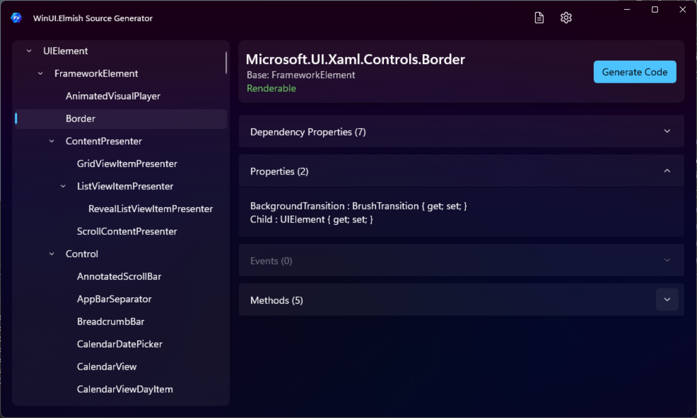

<h1 align="center">WinUI.Elmish</h1>

---

WinUI is a modern desktop framework for Windows 11 (and latest versions of Windows 10). This project is an Elmish implementation for WinUI with the amazing F# programming language.
The implementation is directly tied to WinUI itself without any unnecessary abstractions, which makes the project easier to understand and maintain.
 WinUI.Elmish is just a wrapper around the WinUI itself with no more or less features. However, some issues do exist because WinUI heavily favors XAML over code-first approach.
Before using this library, make yourself comfortable with the Elmish architecture and WinUI.

- [Elmish project](https://elmish.github.io/elmish/)
- [The Elmish Book](https://zaid-ajaj.github.io/the-elmish-book/#/) by Zaid Ajaj
- [WinUI docs](https://learn.microsoft.com/en-us/windows/apps/get-started/)
- [WinUI Gallery](https://apps.microsoft.com/detail/9P3JFPWWDZRC?hl=en-us&gl=AE&ocid=pdpshare) app

---

A brief introduction to the project is available [here](./documentation.md).

The projects relies on the WinUI experimental release channel because of the following features:
 - Code-First DataTemplate creation
 - Code-First theme binding

As of version 2.6.6 these two features on the stable channel are only possible via XAML.

### Source Generator

I have created a source generator (with WinUI.Elmish itself) that generated all controls of WinUI.

